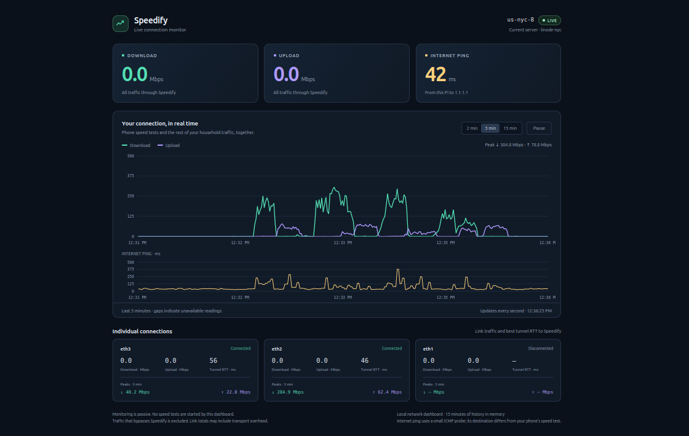
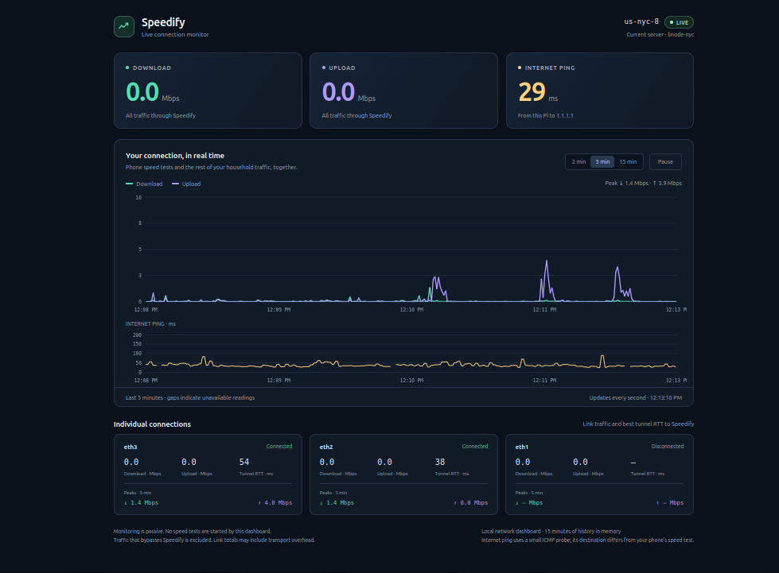

# Speedify LAN Dashboard

A lightweight, read-only web dashboard for a Linux machine running Speedify. See your bonded connection from any browser on the same home network—without opening a desktop session or watching constantly changing CLI output.

Built for headless Raspberry Pi routers and other Linux bonding gateways. The application uses Python's standard library and serves its own web page: no Apache, database, pip packages, or external frontend dependencies.

**Version 1.1.0 · Unofficial community project.**



*A five-minute window of household traffic, with observed combined peaks of 304.8 Mbps download and 78.8 Mbps upload. Each connection retains its own peaks below the graph.*



*Live dashboard during light household traffic, with a five-minute window selected. Peaks show earlier activity even when current traffic is idle.*

## What it shows

| View | Measurements |
| --- | --- |
| Combined tunnel | Current download/upload, scrolling traffic graph, and peak download/upload |
| Individual connections | Current download/upload, tunnel RTT, connection status, and peak download/upload |
| Internet ping | A small ICMP probe from the gateway to a configurable IPv4 destination |
| Server | The Speedify server tag and datacenter reported by the local CLI |

- Choose a **2-, 5-, or 15-minute window**. Every peak follows that window.
- Pausing freezes the charts and peak window; current numbers keep updating.
- Previously active connections retain their peaks while samples remain in the selected window, including after disconnection.
- Keep the latest **15 minutes in RAM**. No traffic-history database or continuous history writes to the SD card.
- Reuse one statistics feed across multiple browser tabs.
- Show missing data as gaps and dashes, rather than invented zero measurements.
- Responsive layout for desktop and phone browsers. Phone access requires the same network or an independently configured private network connection.

This is a traffic monitor, not a speed-test service. Run a phone or desktop speed test through the gateway, and the dashboard shows it alongside the other traffic using the tunnel.

## Requirements

- A Linux device with **Python 3.9+**, **systemd** for automatic startup, and Speedify already installed and working.
- Speedify CLI at `/usr/share/speedify/speedify_cli`.
- A fixed or DHCP-reserved private IPv4 address on the gateway interface reachable from your browser.
- `ping` from `iputils-ping` for the separate internet-ping reading. Link RTT measurements come from Speedify and do not require it.

The application has been used successfully on a Raspberry Pi 4 with Ethernet-connected internet sources. Compatibility with other Speedify releases should be checked against their CLI statistics format.

## Install

Download or clone this repository onto the device running Speedify. Open a terminal in its directory and run:

```bash
sudo bash install.sh --bind YOUR_GATEWAY_LAN_IP
```

Replace `YOUR_GATEWAY_LAN_IP` with the private address used to reach that device from your desktop. Do not use an ISP public address, the remote Speedify server address, or a wildcard address.

The installer uses the normal account that invoked `sudo`. If logged in directly as root, specify an existing non-root account:

```bash
sudo bash install.sh --bind YOUR_GATEWAY_LAN_IP --user YOUR_LINUX_USER
```

Open `http://YOUR_GATEWAY_LAN_IP:8088` in your browser. Use `--port 8089` if the default port is already occupied, and change the browser address accordingly.

The app starts at boot through `speedify-dashboard.service`. Files are installed to `/opt/speedify-dashboard`; the service unit is `/etc/systemd/system/speedify-dashboard.service`. Close SSH after installation—the monitor stays running.

If a local firewall is enabled, allow access to the selected port from the intended LAN clients. The installer does not modify firewall, router, DNS, DHCP, or Speedify settings.

### Existing installations

Use the same installation command with the existing LAN address, account, and port to update the application. Reinstallation restarts **only the dashboard service** and clears its in-memory history. It does not restart the Speedify daemon.

Back up local code changes before reinstalling. Historical single-file installers and patch scripts are not needed for a fresh installation from this repository: the combined and per-connection peak features are already included.

## How to interpret the numbers

The combined throughput uses Speedify's synthetic connection whose `adapterID` is `speedify`. `receiveBps` and `sendBps` are **bits per second**, divided by 1,000,000 for Mbps.

Individual connection records are grouped by adapter. Their traffic may include transport overhead, retransmissions, or redundant packets. **Do not expect their sum to equal the combined useful traffic exactly.** The app does not add physical-link traffic to the synthetic combined total.

Each link's RTT is the lowest valid reported latency among its connected, awake tunnels. The separate internet ping follows the Linux host's route to `1.1.1.1` by default. These destinations and measurement methods can differ from an external speed test's ping.

Peaks are the highest observed samples in the selected window, not estimates of maximum connection capacity. Readings arrive approximately once per second, so very short bursts may not be captured. Configured Speedify bypass traffic is excluded from the combined tunnel graph.

History begins when this process starts and is collected even when no browser is open. History is not preserved across service restarts or reboots.

## Manual use and demo

Run manually on loopback (the default):

```bash
python3 dashboard.py
```

Or bind to the gateway's specific LAN address:

```bash
python3 dashboard.py --bind YOUR_GATEWAY_LAN_IP --port 8088
```

Choose another ping destination with `--ping-target IPV4_ADDRESS`.

For UI inspection without Speedify, explicitly enable simulated data:

```bash
python3 dashboard.py --demo --bind 127.0.0.1 --port 8089
```

The demo is prominently labeled **DEMO MODE**. It does not measure a real connection.

## Troubleshooting

Check the service and recent errors:

```bash
sudo systemctl status speedify-dashboard --no-pager
sudo journalctl -u speedify-dashboard -n 40 --no-pager
```

If the page opens but traffic does not appear, confirm that the local CLI works from the service account:

```bash
/usr/share/speedify/speedify_cli -s stats 3
```

Look for `connection_stats` messages containing the `speedify` aggregate and physical connection records. CLI format differences may require a parser update. If ping is missing:

```bash
sudo apt install iputils-ping
sudo systemctl restart speedify-dashboard
```

The service runs as a non-root user with a restricted raw-socket capability for ICMP. Some local API policies or container restrictions can prevent CLI access or ping even when the page itself is available.

## Intended network scope

This server is for a **trusted local network**, with no application login. It binds to an explicit private IPv4 address, checks client/Host/origin information, and exposes only read-only HTTP routes. Those checks are not a substitute for authentication or network isolation.

Do not expose the port through public forwarding or a public reverse proxy. No cloud hosting is required. To reach the monitor away from home, use an independently secured private network-access solution.

The dashboard does not disable Speedify's API protection, accept commands over HTTP, collect account passwords, or send analytics to external services. The only independent external measurement is the small ping probe.

## Stop or uninstall

```bash
sudo systemctl disable --now speedify-dashboard
```

After stopping it, remove its installed files if desired:

```bash
sudo rm /etc/systemd/system/speedify-dashboard.service
sudo systemctl daemon-reload
sudo rm -r /opt/speedify-dashboard
```

## Development

No Speedify account or running daemon is needed for the automated tests:

```bash
python3 -m unittest -v test_dashboard.py
node test_frontend.cjs
bash -n install.sh
```

Node.js is needed only for frontend development checks, not to run the dashboard. Tests cover the real CLI subprocess boundary using a fake data producer, local HTTP responses, stale/disconnected readings, history cursors, unit conversion, and per-connection peak calculations. Browser appearance and live Linux/Speedify compatibility still need validation on each target setup.

See [CHANGELOG.md](CHANGELOG.md) for release notes and [CONTRIBUTING.md](CONTRIBUTING.md) for reporting or developing changes.

## References

- [Speedify CLI guide](https://support.speedify.com/article/285-speedify-cli)
- [Synthetic aggregate and per-connection statistics](https://speedify.github.io/speedify-sdk-docs/desktop/gettingstarted.html)
- [Connection-statistics fields and units](https://speedify.github.io/speedify-sdk-docs/ios/Structs/ConnectionStats.html)

Speedify is the name of the underlying VPN product. This independent dashboard is not an official Speedify product.
